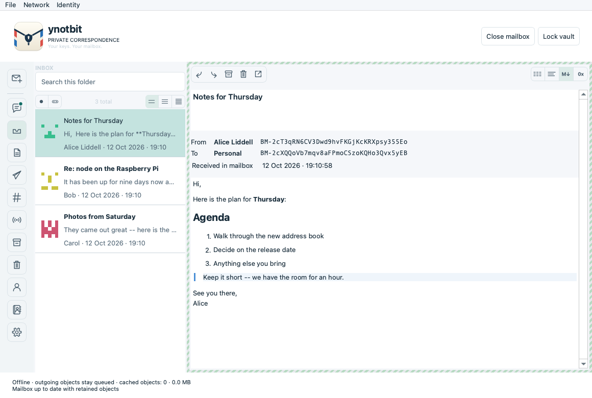
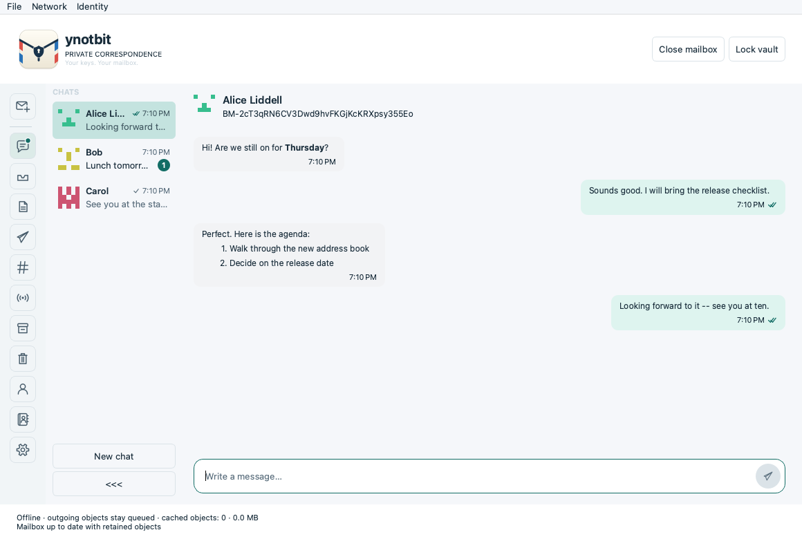
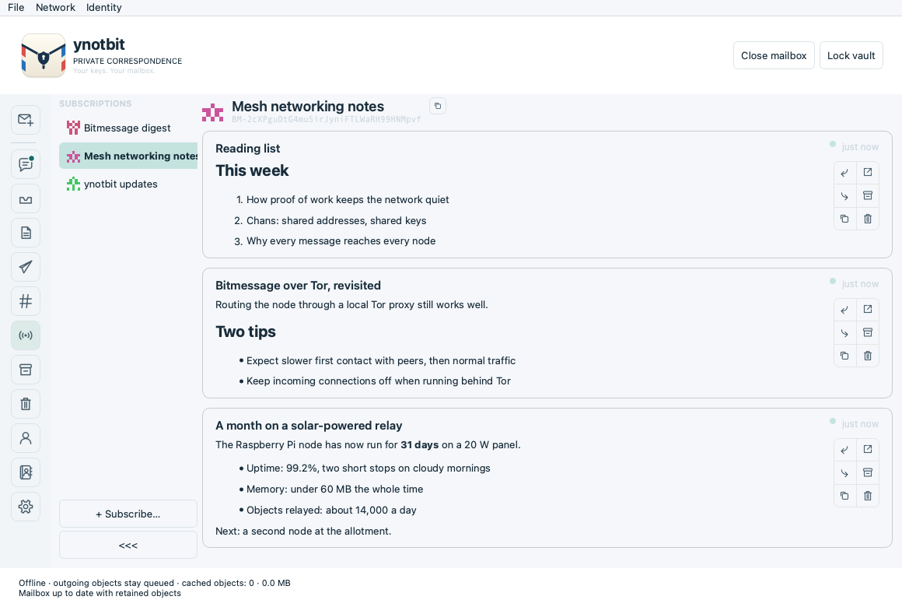
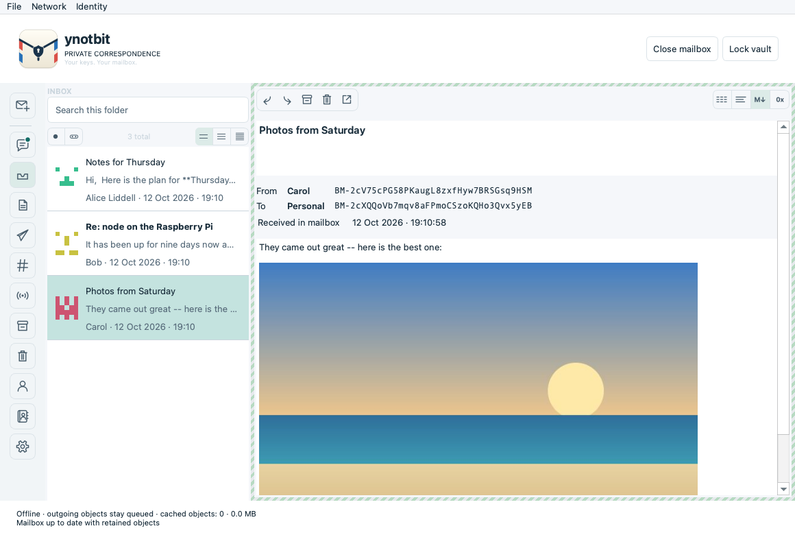
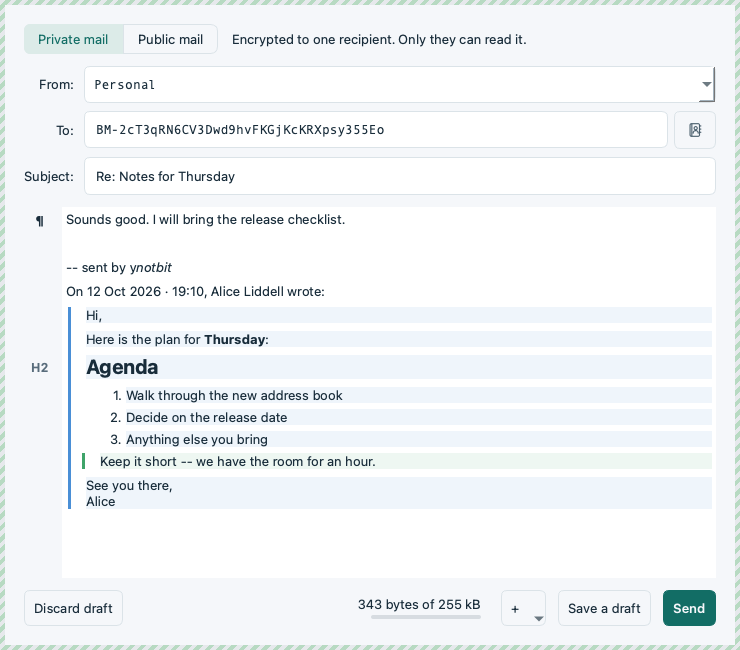
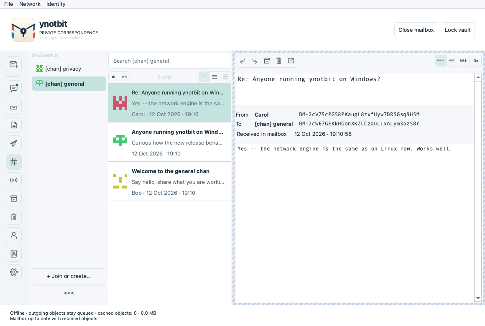
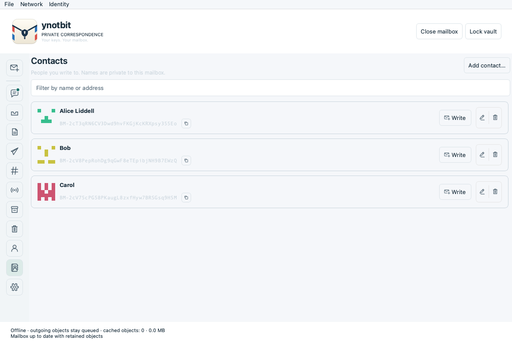
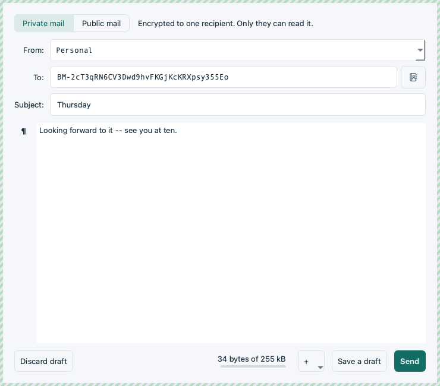

# ynotbit — why not bit?

**English** | [日本語](README.ja.md) | [한국어](README.ko.md) | [简体中文](README.zh-CN.md) | [繁體中文](README.zh-TW.md) | [Русский](README.ru.md) | [Українська](README.uk.md)

A compact desktop Bitmessage client based on [notbit](https://github.com/bpeel/notbit),
by [yshurik](https://github.com/yshurik). **Current release: 0.7.1.**

ynotbit keeps identity keys in a password-protected vault and correspondence in a
separate encrypted mailbox document. Its keyless relay continues collecting
network objects while the vault is locked. Unlocking inspects retained objects
and saves matching letters to the mailbox.



| Chats | Subscriptions | Pictures in a letter | Replying |
|---|---|---|---|
|  |  |  |  |

| Chans | Contacts | Writing to a contact |
|---|---|---|
|  |  |  |

## Download

[**v0.7.1 release**](https://github.com/yshurik/ynotbit/releases/tag/v0.7.1) — prebuilt,
CI-tested downloads for Linux (x86_64), macOS (Apple Silicon), and Windows (x86_64).
See [Current boundaries](#current-boundaries) below for what each build does and doesn't
guarantee.

**macOS:** the app is ad-hoc signed and not notarized, so macOS keeps the downloaded
copy quarantined. After moving `ynotbit.app` to `/Applications`, clear that once:

```sh
sudo xattr -cr /Applications/ynotbit.app
```

## Using the app

1. Create or open a `.bmvault` file. **File → Create vault…** (or **Create vault** on the
   lock screen) opens one dialog that makes the vault and its first identity, from random
   keys or a secret phrase, with an optional search for a shorter address.
   **Identity → Create identity…** uses the same dialog; you can also import `keys.dat`
   or join a chan using its shared phrase and expected address.
2. Create or open a `.bmmail` document in Documents or another writable folder.
3. Choose **Write a letter**, select the sender, and pick a recipient: type a
   contact's name or a BM-address, or use the contacts button beside **To**.
   Changes automatically save in the encrypted mailbox.
4. Choose **Send**. Existing drafts have an **Edit / Send** control.
5. Follow progress in **Outbox**. Key lookup and proof of work can take time;
   recipient acknowledgment is asynchronous and is not a read receipt.
6. Lock the vault when finished. Preparation pauses, the mailbox closes, and
   the relay continues handling already submitted encrypted network objects.

To name someone, click the person-plus button beside their address in a letter,
or use **Contacts → Add contact…**. Names then appear in the message list, the
reader and the composer, always next to the full address.

To chat, open **Chats** in the rail and choose **New chat**: type a contact's name or a
BM-address, and pick the identity to chat as when you have several. Messages are
Markdown; Enter sends and Shift+Enter starts a new line. A chat keeps its identity, so
the same person under two identities is two chats. The tick under your message shows how
far it has got: waiting, sent to the network, delivered (the recipient's acknowledgment,
not a read receipt). A chat message lives on the network for 24 hours, and one not
delivered by then shows as expired; chats stay in your mailbox and its backups, out of
the Inbox.

To follow a sender's broadcasts, open **Subscriptions** and choose **+ Subscribe…**
(or **Identity → Subscribe to broadcasts…**); their posts appear as a feed. New
mailboxes already follow the Bitmessage digest, and ynotbit's own update notices.

To add a picture to a letter, use the **+** button in the composer, the
right-click menu, or drop image files on the letter.

**File → Back up mailbox and vault** saves both documents. Keep both: a mailbox
alone cannot recover its encryption key. Changing a password does not invalidate
old vault copies or backups. Import preserves the original plaintext `keys.dat`.

## Features

- Portable vault: Argon2id (64 MiB, 3 passes) and XChaCha20-Poly1305; guarded key
  allocations; password changes; identity labels; deterministic v3/v4 chans. One dialog
  makes a vault with its first identity: random keys, or keys from a secret phrase derived
  as PyBitmessage derives them, with an optional search for a shorter address.
- SQLCipher mailbox: drafts, message bodies, addresses, public keys, delivery
  records, acknowledgment tokens, subscriptions, and checkpoints remain encrypted.
  Existing v1 mailbox documents migrate transactionally without losing drafts.
- Sending with public recipient keys; v2/v3/v4 public-key lookup and responses;
  cancellable background proof of work on every CPU core but one and on the GPU
  (Metal on macOS, OpenCL elsewhere); persistent outbox and delivery history.
- Direct-message decryption and sender verification; acknowledgments; bounded
  automatic expiry retries; manual retry and cancellation; reply using the
  authenticated sender key. Cancellation cannot recall objects already relayed.
- Address book: contacts with local, private names, kept in the encrypted
  mailbox and never sent. One-click add from any letter; names in the list,
  reader and composer (completion by name and a contacts picker); the full
  address always stays visible beside a name.
- Channels are named `#<name>`. A public channel's name is its shared phrase
  (`bitmessage` is `#bitmessage`); a secret one has a name of your own and a phrase
  typed hidden. Older `[chan] <phrase>` names become `#<phrase>` when the vault opens.
  Channels have a named selector, separate message lists and search, and a Write to channel
  action. The chan list collapses to a column of identicons with unread dots.
  BM-addresses use a fixed-width font; each address has a GitHub-style identicon.
- The reader frames each letter by kind (personal, chan personal, anonymous chan
  post, broadcast) and offers plain, text, Markdown and hex views, detecting
  Markdown and unreadable binary automatically. The subject, details and body scroll
  as one.
- Message details align sender and recipient addresses, color successful
  acknowledgment, and show the recorded delivery timeline: prepared, key
  available, sent to peers, acknowledged, or received in the mailbox.
- Broadcast publishing (v4/v5 objects) and **Subscriptions**: followed senders in a
  rail like the chan list, and each sender's posts as a feed of cards with Reply
  privately, Forward, Copy text, Open in window, Archive and Trash. New mailboxes
  follow the Bitmessage digest. Shared chans, folder search that runs in the
  background, read state, archive, trash/restore, and explicit permanent deletion.
- **Chats**: one-to-one conversations on a page of the main window. The list shows each
  peer's picture and name, the newest message and its time, a delivery tick for yours and
  an unread count, with a dot on the Chats button; the conversation shows Markdown
  messages in bubbles with their time and tick. A chat is between one of your identities
  and one peer and keeps that identity. Enter sends, Shift+Enter starts a line; links ask
  first and open only `https`. A chat message is an ordinary Bitmessage message with an
  empty subject and a small JSON body, which the network keeps 24 hours; it uses a
  letter's proof of work, publishing and acknowledgment, stays out of the Inbox, and
  stays in your mailbox and its backups after the network has dropped it.
- Update notices: signed broadcasts from ynotbit's release address
  (`BM-2666hf5eAbjCJMaPwC7eG3Um55QJGM`) show a banner when a newer version is out,
  without subscribing; **Settings → Notifications** turns them off.
- A separate notbit relay, on Linux, macOS and Windows, receives no vault or
  mailbox keys. It identifies itself to peers as `/ynotbit:<version>/`. Its bounded local
  queue accepts network objects, validates proof of work, and records acceptance,
  rejection, and offers to connected peers. Receipt state survives restarts.
  With peers that offer it (PyBitmessage, MiNode), the link switches to TLS after the
  handshake, as PyBitmessage does: anonymous ECDH, which hides the traffic from a passive
  observer but does not authenticate the peer.
- Network objects live in one SQLite file, `objects.sqlite`, which the relay writes
  and prunes to the retention limits and the app reads, so new objects reach the
  mailbox on the next refresh.
- The desktop uses Qt Widgets, without QML or Qt Quick. A painted list keeps at
  most three pages of 100 message summaries, loading only the selected body.
- The composer is a visual Markdown editor. The mark beside each paragraph (¶,
  H1–H6, list, code) opens **Turn into**, as in MarkText. Replies quote the letter
  email-style with `>` in the same editor: quoted text can be edited but stays
  quoted, and the reader shows quote levels as coloured bars. Letters can be
  forwarded.
- Pictures travel inside the letter as standard Markdown `data:` URLs, shrunk to
  fit one letter, since Bitmessage has no attachments. The reader shows them, and
  PyBitmessage's inline pictures too; only PNG, JPEG, GIF and WebP load.
  Rendered messages use a safe Markdown document that does not fetch local files
  or remote images. Appearance follows the system color scheme by default and can
  be set to light or dark.
- Interface in English, Simplified and Traditional Chinese, Japanese, Korean,
  Russian and Ukrainian. It follows the system language, or pick one under
  **Settings → Appearance** (applies after a restart). Dates follow the chosen language.
- Peer count, offline mode, node restart, and a **Settings** page of the main window (the
  gear in the rail, or **File → Settings…**) with Network (additional peer, SOCKS5 proxy,
  incoming connections, router port), Storage, Sending, Appearance, Notifications and
  Security sections; configurable network-cache retention, recent document paths, and
  combined backup.

Delivery distinguishes **queued → requesting key → preparing receipt → proof of
work → waiting for peers → awaiting acknowledgment → acknowledged**. Broadcasts
and chan messages can finish as **published**, without a recipient receipt.
An offer to peers is not proof that every peer or the final recipient received it.

## Build and test

Requirements: CMake 3.22+, C++20, Qt 6.8+ (Core, Gui, Widgets, Network, Test), OpenSSL, libsodium, SQLCipher, pkg-config, Ninja.
Python 3 runs the loopback relay tests. Autoconf, Automake, make and Tcl are
needed when building the pinned storage dependencies from source.

```sh
scripts/build-dependencies.sh /absolute/scratch /absolute/deps
export PKG_CONFIG_PATH=/absolute/deps/lib/pkgconfig
cmake -S . -B build -G Ninja \
  -DCMAKE_PREFIX_PATH=/absolute/Qt/6.8.3/macos \
  -DCMAKE_BUILD_TYPE=Release
cmake --build build --parallel 4
ctest --test-dir build --output-on-failure
```

On Linux, use your Qt installation's `gcc_64` directory. The executable target
is `ynotbit`; macOS produces `ynotbit.app`. Tests use temporary documents and
loopback peers, never public-network messages. The independent wire fixtures can
be regenerated with `tests/generate_wire_fixtures.py` using Python cryptography
50.0.1; the normal test suite does not need that package.

On Windows, build with MSVC and Ninja; get OpenSSL, libsodium, and SQLCipher via
[vcpkg](https://github.com/microsoft/vcpkg) (`vcpkg.json` manifest, `x64-windows`
triplet) instead of `build-dependencies.sh`, and pass
`-DCMAKE_TOOLCHAIN_FILE=<vcpkg>/scripts/buildsystems/vcpkg.cmake`. See
`.github/workflows/release.yml` for the exact, CI-verified sequence on all three
platforms.

Translations live in `translations/ynotbit_<lang>.ts` and can be edited with Qt
Linguist or any text editor. After changing user-visible strings in the code,
run `cmake --build build --target update_translations` to refresh the files;
`scripts/check-translations.py` (also a test) fails on untranslated entries or
broken `%1` placeholders. Error messages from the storage and protocol layers are
collected by `scripts/update-error-catalog.py`.

The README screenshots come from demo data, not a real mailbox. Regenerate them
with `cmake --build build --target readme_screenshots` and
`QT_QPA_PLATFORM=offscreen build/readme_screenshots docs/images`; each translated
set, with demo letters in its language, with `... docs/images/<lang> <lang>` for `ja`, `ko`,
`zh_CN`, `zh_TW`, `ru` and `uk`.

To package a build for redistribution, with Qt's runtime libraries bundled in:

```sh
# macOS
scripts/package-macos.sh /absolute/build /absolute/ynotbit-macos-arm64.zip /absolute/Qt/6.8.3/macos
# Linux — builds a single self-contained AppImage with linuxdeploy
scripts/package-linux.sh /absolute/build /absolute/ynotbit-x86_64.AppImage /absolute/Qt/6.8.3/gcc_64
```
```powershell
# Windows
scripts/package-windows.ps1 -BuildDir C:\absolute\build -OutputZip C:\absolute\ynotbit-windows-x86_64.zip `
  -QtBinDir C:\absolute\Qt\6.8.3\msvc2022_64\bin -VcpkgBinDir C:\absolute\build\vcpkg_installed\x64-windows\bin
```

## Documents, network data, and portability

Vault and mailbox documents live wherever you choose. The node/cache directory
uses Qt's application-data location. Its internal application identifier remains
`NotbitDesktop/Notbit Desktop` for compatibility with the earlier alpha's cache.
`--data-dir /absolute/path` overrides the node folder. `--portable` uses
`./notbit-data/node` relative to the launch directory. `--offline` starts without
network connections. The relay stops when the application exits. The relay accepts
incoming connections on port 8444 (never when a proxy is set) and asks the router to open
that port with UPnP; **Settings → Network** turns either off.

Default network retention is 2 GiB / 90 days, kept by the relay in `objects.sqlite`
in the node folder; change it under **Settings → Storage**.
Local retention can outlive protocol expiry, allowing later unlocked inspection.
Discarding a retained object can prevent later recovery; already saved mailbox
letters are unaffected. Proof of work runs on every CPU core but one, and on the
GPU when there is one; `YNOTBIT_NO_GPU=1` leaves it to the CPU.

## Current boundaries

This remains development software. Local tests cover document migration,
malformed objects, protocol fixtures, real proof of work, controller delivery,
lock/reopen, desktop actions, and real loopback relay publication. This is not
an independent security audit or a public-network interoperability certification.
Lock releases guarded keys and closes access; Qt/OS copies of displayed plaintext
are not guaranteed erased from all memory, swap, crash dumps or screenshots.

The packaged macOS build targets **Apple Silicon, macOS 15.6+** and bundles its
runtime dependencies. It is ad-hoc signed, not Developer ID signed or notarized.
Since 0.5.0 the Windows build runs the notbit engine too, through a small
Winsock layer (`third_party/notbit/src/ntb-win32.c`). Windows has no signal the
app can send the node to stop cleanly, so the node is terminated on exit; work
the store had queued but not yet written is dropped.
The Linux download is a single AppImage. File attachments (other than pictures
carried inside a letter) and configurable CPU parallelism are not implemented.

`.github/workflows/release.yml` builds, tests, and packages Linux, macOS, and
Windows on every `v*` tag push (or manual dispatch), then attaches the three
archives to a GitHub Release. `docs/ci/build.yml` is an older, unused template
for a lighter continuous build-and-test workflow (every push/PR, no packaging);
it's not wired into `.github/workflows/` yet.

See [verification](docs/verification.md), [architecture](docs/design.md),
[implementation plan](docs/superpowers/plans/2026-09-13-complete-messaging.md),
and [third-party attribution](THIRD_PARTY.md). Original ynotbit code is MIT
licensed; vendored components retain their own licenses.
